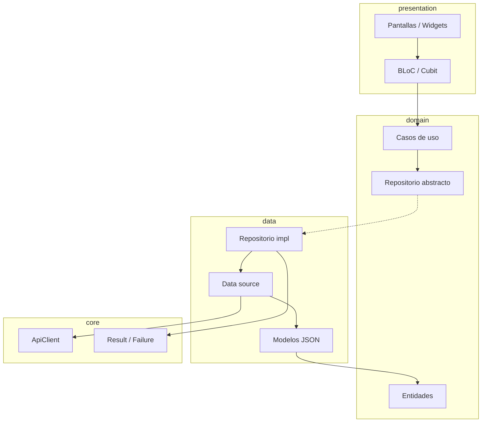
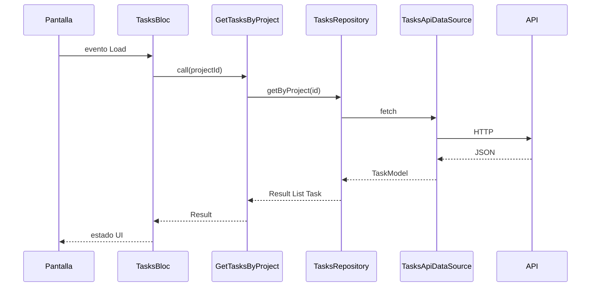

# Clean Architecture — cliente Flutter (TaskBoard)

Documento de decisiones (ADR) del frontend `frontend/lib`, organizado en capas **domain**, **data** y **presentation** por funcionalidad. La migración se hizo en las entregas CA-0…CA-6 sin cambiar el comportamiento visible de la app; este documento describe el estado final.

## Contexto

Antes de la migración el cliente usaba BLoC, GoRouter, modelos `json_serializable` en `lib/models` y un único `TaskboardDataSource` (local o API) en `lib/services`. Faltaban dominio (entidades, repositorios, casos de uso), DI centralizada y organización por funcionalidad. Tras CA-6 ya no quedan `lib/blocs`, `lib/models`, `lib/services`, `lib/screens`, `lib/widgets` ni `lib/utils`, y los modelos JSON son clases escritas a mano en `data/models/` de cada feature (sin generación de código).

## Capas

| Capa | Responsabilidad | Puede importar |
|------|-----------------|----------------|
| **domain** | Entidades, contratos de repositorio, casos de uso (Dart puro) | Solo Dart estándar, `equatable` |
| **data** | DTO (`*Model`), data sources, mappers, implementaciones de repositorio | domain, core (config, error, network, storage) |
| **presentation** | BLoC/Cubit, pantallas, widgets | domain, shared, flutter |

**Regla de dependencias:** `presentation → domain ← data`. Presentation **no** importa `data/` (excepción: wiring en `core/di`).

## Estructura de carpetas

```
lib/
  core/
    config/         # AppConfig (assets/data/config.json), WorkspaceRemoteSettings
    di/injection.dart
    error/          # Result, Failure, excepciones de data y su traducción
    network/        # TaskboardApiClient, TokenProvider, api_response (HTTP → excepción)
    storage/        # StorageService (JSON local del modo sin API)
    usecase/        # UseCase<T, P>, NoParams
  features/
    ai_assistant/
    auth/
    projects/
    tasks/
  shared/
    router/         # AppRouter (GoRouter)
    themes/
    ui/             # kRootScaffoldMessenger
    utils/          # fastApiDetailFromErrorString
  main.dart
```

`test/architecture/dependency_rule_test.dart` comprueba que `lib/` solo contiene `core`, `features`, `shared` y `main.dart`.

Cada feature:

```
features/<feature>/
  domain/
    entities/
    repositories/   # contratos
    usecases/       # un caso de uso por fichero + barrel <feature>_usecases.dart
    services/       # (opcional) reglas puras de dominio, p. ej. ai_task_conversion
  data/
    models/         # *Model: JSON del API (fromApiJson) y del almacenamiento local (fromJson)
    datasources/    # contrato + implementaciones API / local
    repositories/   # *RepositoryImpl → Result<T>
  presentation/
    bloc/           # BLoC o Cubit
    screens/
    widgets/
    utils/          # (opcional) ayudas de UI, p. ej. mensajes de error
```

| Feature | Entidades | Casos de uso |
|---|---|---|
| `auth` | `AuthUser` | `Login`, `Logout`, `RestoreSession`, `ChangePassword` |
| `tasks` | `Task`, `Subtask`, `TaskStatus`, `TaskComplexity` | `GetTasksByProject`, `CreateTask`, `UpdateTask`, `UpdateTaskStatus`, `MoveTask`, `DeleteTask` |
| `projects` | `Project`, `ProjectMember`, `AppUser`, `WorkspaceSuggestion`, `WorkspaceInventory`, `IdePrompt`… | 19: proyectos (`GetProjects`, `GetProject`, `CreateProject`, `UpdateProject`, `UpdateProjectStatus`, `DeleteProject`), miembros (`GetProjectMembers`, `GetRegisteredUsers`, `AddProjectMember`, `UpdateProjectMemberRole`, `RemoveProjectMember`), workspace (`PreviewWorkspaceSnapshot`, `SyncProjectWorkspace`, `GetWorkspaceSuggestions`, `ApplyWorkspaceSuggestion`, `DismissWorkspaceSuggestion`, `GetWorkspaceInventory`, `ExportTaskboardMd`) e IDE (`PrepareIdeSession`) |
| `ai_assistant` | `AiTaskSuggestion`, `AiChatMessage`, `AiChatReply`, `AiSuggestionResult`, `AgentSession`, `AgentRun`, `AgentStreamEvent` | `SuggestTasks`, `SuggestProjectPlan`, `SendProjectChatMessage`, `ApplyAiTaskSuggestions`, `CreateProjectFromAiPlan`, `StreamAgentRun`, `GetAgentSession`, `ResetAgentSession`, `GetAgentRuns` |

## Errores

- **`Result<T>`** en `core/error/result.dart`: `Success<T>` o `ResultFailure<T>` (envuelve `Failure`).
- **`Failure`**: `NetworkFailure`, `UnauthorizedFailure`, `NotFoundFailure`, `ServerFailure`, `ValidationFailure` (reglas de entrada de un caso de uso), `UnexpectedFailure`.
- Excepciones en **data** (`ServerException`, …); los repositorios las traducen a `Failure` con `mapExceptionToFailure`.

## Datos: API y modo local

- La app funciona contra el API TaskBoard o, si no hay API configurada, en **modo local** (SharedPreferences). La elección se hace una vez en `configureDependencies`.
- `tasks` y `projects` tienen un contrato de data source (`TasksDataSource`, `ProjectsDataSource`) con dos implementaciones: `*ApiDataSource` (sobre `TaskboardApiClient`) y `*LocalDataSource` (sobre `StorageService`). Los repositorios no saben cuál reciben.
- `StorageService` solo guarda colecciones JSON (`projects`, `tasks`) dentro de la clave `app_data`, con el mismo formato que usaba la versión anterior; cada feature lee y escribe sus mapas con su `*Model`. Borrar un proyecto en local borra también sus tareas.
- `core/network/api_response.dart` traduce las respuestas HTTP a excepciones de data (401 → `UnauthorizedException`, 403 → `ServerException` con «Permiso denegado», 404 → `NotFoundException`, resto → `ServerException` con código y cuerpo) y `guardApiCall` envuelve los errores de red con la operación.
- `auth` y `ai_assistant` usan el mismo criterio: sin API, el repositorio se registra sin data source remoto (sesión de demostración y asistente desactivado).

## Casos de uso

- Base: `UseCase<T, P>` con `Future<Result<T>> call(P params)`.
- `NoParams` cuando no hay parámetros.
- Una clase por acción expuesta a la UI (p. ej. `GetTasksByProject`).

## Sesión (auth)

- `TokenProvider` en `core/network/` es la interfaz de la que `TaskboardApiClient` lee el token; la implementa `AuthLocalDataSource` (data de auth), así core no depende de features.
- `AuthRepositoryImpl` funciona en dos modos según la configuración: con `AuthRemoteDataSource` (API JWT) o sin él (modo local de demostración, `DemoAuthLocalDataSource`). La elección se hace en `configureDependencies`.
- El router necesita una comprobación síncrona: recibe `isAuthenticated` y el stream `sessionChanges` del repositorio desde `AppDependencies`, no el repositorio.
- El diálogo de cambio de contraseña espera el resultado, así que usa el caso de uso `ChangePassword` expuesto por `AuthBloc` (mismo patrón que `TasksBloc.createTask`).

## Asistente IA (ai_assistant)

- Sin API Taskboard configurada, `AiAssistantRepositoryImpl` se registra sin data source remoto: las consultas devuelven un `Failure` con el aviso de configuración y la sesión agent queda vacía.
- El repositorio conserva el texto original del error (código HTTP y cuerpo, `TimeoutException`, `ClientException`) en el `Failure`, porque `describeAiFailure` (`presentation/utils/`) elige el mensaje para el usuario a partir de él.
- El stream de Cursor Agent se expone como `Stream<Result<AgentStreamEvent>>`: un error llega como un último `ResultFailure`, no como excepción. `StreamAgentRun` no implementa `UseCase` porque no devuelve un `Future`.
- Las reglas puras que comparan el borrador de la IA con las tareas del proyecto están en `domain/services/ai_task_conversion.dart`; `ApplyAiTaskSuggestions` las usa y crea las tareas con el caso de uso `CreateTask` de tasks.
- Alta de un proyecto con IA: el diálogo «Nuevo Proyecto» abre `ProjectAiChatPanel` en modo `create` (`showNewProjectAiChatSheet`). El primer mensaje pide el plan con `SuggestProjectPlan` y `CreateProjectFromAiPlan` crea el proyecto con `CreateProject` y luego sus tareas con `ApplyAiTaskSuggestions`. Si fallan las tareas, el proyecto ya existe y el resultado lo indica en `taskFailure`. En este modo no se ofrece Agent, que necesita la carpeta de un proyecto creado.
- El título y la descripción del proyecto viajan siempre en `projectContext`, como datos separados del mensaje del usuario.
- Los Cubits son por pantalla: `ProjectAiChatPanel` y `TaskForm` crean el suyo con `BlocProvider(create: (_) => sl<…>())`. Las acciones cuyo resultado muestra la UI en un aviso (`resetAgentSession`, `applyNewTasks`, `createProjectFromDraft`) devuelven el `Result`.

## Inyección de dependencias

- **get_it** en `core/di/injection.dart`.
- `registerLazySingleton` para data sources, repositorios y casos de uso.
- `registerFactory` para BLoCs.

## Tests

- **mocktail** y **bloc_test**; los data sources del API se prueban con `MockClient` de `package:http/testing.dart` (`TaskboardApiClient` acepta un `httpClient`).
- `test/architecture/dependency_rule_test.dart`: domain sin Flutter/HTTP/JSON ni otras capas; presentation sin imports de `data/`; `lib/` solo con `core`, `features`, `shared` y `main.dart`; `core` sin imports de features (salvo `core/di`).
- Verificación local y en CI: `scripts/flutter-check.sh` (analyze + test; con `--vs-main` o `--base`, sin avisos nuevos respecto a la base; con `--strict`, sin ningún aviso). Desde octubre de 2026 `main` no tiene avisos de `flutter analyze` y el CI no admite ninguno, tampoco los de nivel info. El CI ejecuta además `flutter test --coverage` y publica la cobertura por capa con `scripts/coverage_by_layer.py`.
- Cobertura al cerrar CA-6 (2026-10-25, 134 tests): domain 84,4 %, data 62,5 %, presentation 65,6 %, core 53,1 %. Solo cuenta los ficheros que cargan los tests, así que en presentation la cifra es optimista.

## Migración (strangler)

| Entrega | Contenido |
|---------|-----------|
| CA-0 | Este documento |
| CA-1 | core + shared + DI + test de arquitectura |
| CA-2 | Feature **tasks** (referencia portfolio) |
| CA-3 | Feature **projects** |
| CA-4 | Feature **auth** |
| CA-5 | Feature **ai_assistant** |
| CA-6 | Limpieza, CI Flutter, docs finales |

Cada entrega: `flutter analyze` y `flutter test` en verde; PR independiente. Todas fusionadas (CA-6 en octubre de 2026).

## Convenciones de nombres

- Repositorio: `TasksRepository` / `TasksRepositoryImpl`
- Caso de uso: verbo + entidad (`GetTasksByProject`, `CreateTask`)
- DTO JSON: `TaskModel`; entidad: `Task`

## Diagrama de capas



## Flujo de una petición



## Añadir una feature nueva

Toma `features/tasks/` como referencia.

1. **Dominio** (`features/<f>/domain/`): entidades con `Equatable`, contrato del repositorio que devuelve `Future<Result<T>>` y un caso de uso por acción de la UI (`UseCase<T, P>`, verbo + entidad), exportados en `<f>_usecases.dart`. Nada de Flutter, HTTP ni JSON.
2. **Datos** (`features/<f>/data/`): `*Model` con `fromApiJson`/`toApiJson` (y `fromJson`/`toJson` si hay modo local), contrato del data source con sus implementaciones (`*ApiDataSource` usando `ensureSuccess` y `guardApiCall`; `*LocalDataSource` sobre `StorageService` si la feature funciona sin API) y `*RepositoryImpl`, que captura excepciones y devuelve `ResultFailure(mapExceptionToFailure(e))`.
3. **Presentación** (`features/<f>/presentation/`): BLoC o Cubit que recibe los casos de uso por constructor; pantallas y widgets que solo hablan con él. Un BLoC global se crea en `main.dart`; uno por pantalla con `BlocProvider(create: (_) => sl<…>())`.
4. **DI** (`core/di/injection.dart`): una función `_register<F>Stack` con `registerLazySingleton` para data sources, repositorio y casos de uso, y `registerFactory` para el BLoC; elegir la implementación API o local según haya `TaskboardApiClient`.
5. **Rutas**: si hay pantallas nuevas, añadirlas en `shared/router/app_router.dart`.
6. **Tests** (`test/unit/`): casos de uso con el repositorio simulado, repositorio con el data source simulado, data source del API con `MockClient`, modelos y BLoC con `bloc_test`.
7. **Verificar**: `scripts/flutter-check.sh --vs-main --strict` (tests en verde, ningún aviso; incluye el test de arquitectura).
