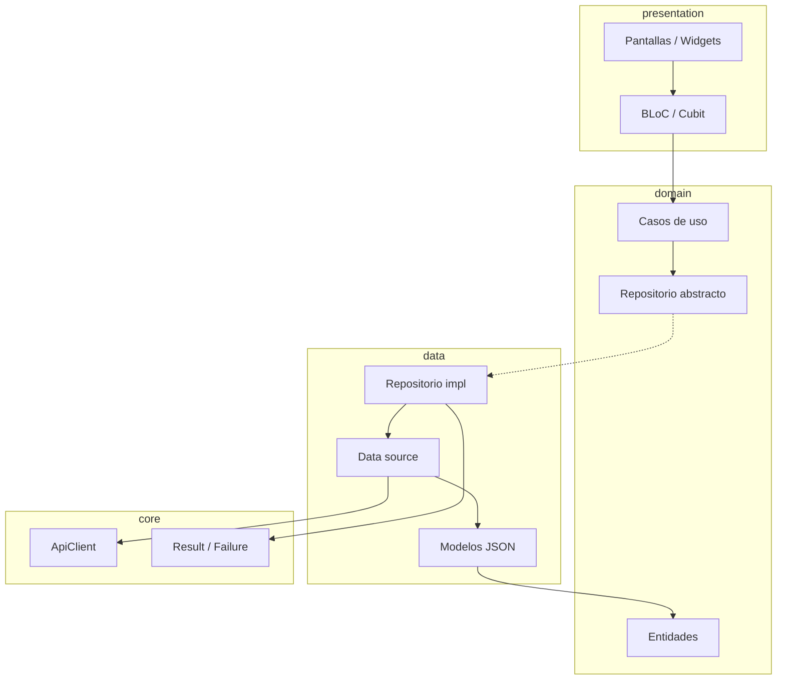
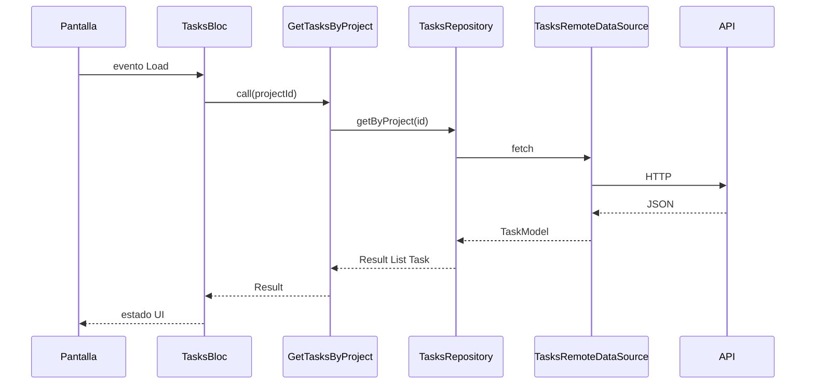

# Clean Architecture — cliente Flutter (TaskBoard)

Documento de decisiones (ADR) para la migración del frontend `frontend/lib` hacia capas **domain**, **data** y **presentation**, sin cambiar el comportamiento visible de la app.

## Contexto

El cliente usa BLoC, GoRouter, `json_serializable` y un `TaskboardDataSource` (local o API). Faltaban dominio (entidades, repositorios, casos de uso), DI centralizada y organización por funcionalidad.

## Capas

| Capa | Responsabilidad | Puede importar |
|------|-----------------|----------------|
| **domain** | Entidades, contratos de repositorio, casos de uso (Dart puro) | Solo Dart estándar, `equatable` |
| **data** | DTO (`*Model`), data sources, mappers, implementaciones de repositorio | domain, core (error, network, storage) |
| **presentation** | BLoC/Cubit, pantallas, widgets | domain, shared, flutter |

**Regla de dependencias:** `presentation → domain ← data`. Presentation **no** importa `data/` (excepción: wiring en `core/di`).

## Estructura de carpetas

```
lib/
  core/
    di/injection.dart
    error/          # Result, Failure, excepciones de data
    usecase/
    network/        # TaskboardApiClient
    storage/        # StorageService
  features/
    auth/
    projects/
    tasks/
    ai_assistant/
  shared/
    router/
    themes/
    ui/
    widgets/        # widgets transversales (fase de migración)
  main.dart
```

Cada feature:

```
features/<feature>/
  domain/{entities,repositories,usecases}/
  data/{models,datasources,repositories}/
  presentation/{bloc,screens,widgets}/
```

Features: `auth`, `projects`, `tasks`, `ai_assistant`.

## Errores

- **`Result<T>`** en `core/error/result.dart`: `Success<T>` o `ResultFailure<T>` (envuelve `Failure`).
- **`Failure`**: `NetworkFailure`, `UnauthorizedFailure`, `NotFoundFailure`, `ServerFailure`, `UnexpectedFailure`.
- Excepciones en **data** (`ServerException`, …); los repositorios las traducen a `Failure` con `mapExceptionToFailure`.

## Casos de uso

- Base: `UseCase<T, P>` con `Future<Result<T>> call(P params)`.
- `NoParams` cuando no hay parámetros.
- Una clase por acción expuesta a la UI (p. ej. `GetTasksByProject`).

## Inyección de dependencias

- **get_it** en `core/di/injection.dart`.
- `registerLazySingleton` para data sources, repositorios y casos de uso.
- `registerFactory` para BLoCs.

## Tests

- **mocktail** en tests nuevos; **bloc_test** para BLoC.
- `test/architecture/dependency_rule_test.dart`: domain sin Flutter/HTTP/JSON; presentation sin imports de `data/`.

## Migración (strangler)

| Entrega | Contenido |
|---------|-----------|
| CA-0 | Este documento |
| CA-1 | core + shared + DI + test de arquitectura |
| CA-2 | Feature **tasks** (referencia portfolio) |
| CA-3 | Feature **projects** |
| CA-4 | Feature **auth** |
| CA-5 | Feature **ai_assistant** |
| CA-6 | Limpieza, CI Flutter, docs finales |

Cada entrega: `flutter analyze` y `flutter test` en verde; PR independiente.

## Convenciones de nombres

- Repositorio: `TasksRepository` / `TasksRepositoryImpl`
- Caso de uso: verbo + entidad (`GetTasksByProject`, `CreateTask`)
- DTO JSON: `TaskModel`; entidad: `Task`

## Diagrama de capas



## Flujo de una petición



## Añadir una feature nueva

1. Crear entidades y repositorio abstracto en `domain/`.
2. DTO, data source e implementación del repositorio en `data/`.
3. Casos de uso (uno por acción de UI).
4. BLoC y pantallas en `presentation/`.
5. Registrar en `configureDependencies`.
6. Tests de caso de uso, repositorio y BLoC; verificar `dependency_rule_test`.
