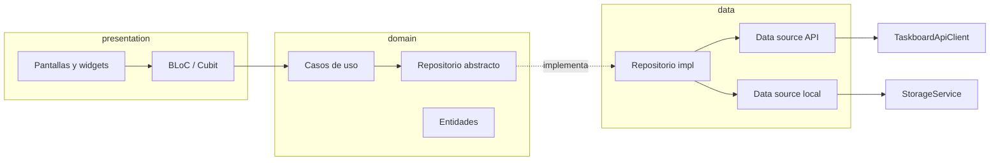

# Frontend (Flutter) – Aplicación Multiplataforma

Aplicación Flutter para Web, Android y Escritorio. Este README está orientado al desarrollo, ejecución y distribución de la app.

---

## Arquitectura

El cliente Flutter sigue **Clean Architecture** por funcionalidad (`ai_assistant`, `auth`, `projects`, `tasks`), con BLoC/Cubit y `get_it`. Decisiones, árbol completo, lista de casos de uso y cómo añadir una feature: [docs/architecture/clean-architecture.md](../docs/architecture/clean-architecture.md).



Regla de dependencias: `presentation → domain ← data`; solo `core/di/injection.dart` conoce todas las capas. Lo comprueba `test/architecture/dependency_rule_test.dart`.

## Características
- Arquitectura basada en BLoC, casos de uso y repositorios.
- Internacionalización (ES/EN).
- Navegación con GoRouter y menú hamburguesa persistente.
- UI responsive (Web/Escritorio/Móvil).
- Navegación personalizada por rol de usuario:
  - **Estudiantes**: Panel Principal, Notificaciones, Mensajes, Anteproyectos, Proyectos, Tareas, Kanban
  - **Tutores**: Panel Principal, Mis Estudiantes, Notificaciones, Mensajes, Anteproyectos, Flujo de Aprobación
  - **Administradores**: Panel Principal, Notificaciones, Gestionar Usuarios, Flujo de Aprobación, Configuración del Sistema

---

## Plataformas soportadas

| Plataforma | Estado | Requisitos mínimos | Comando rápido |
|-----------|--------|--------------------|----------------|
| Web       | Estable | Navegador moderno | `flutter run -d chrome` |
| Windows   | Estable | Windows 10+       | `flutter run -d windows` |
| Android   | Estable | Android Studio/SDK| `flutter run -d android` |
| macOS     | Opcional| Xcode + macOS     | `flutter run -d macos` |
| Linux     | Opcional| Toolchain GTK     | `flutter run -d linux` |

> Habilita plataformas si es necesario: `flutter config --enable-web --enable-windows`

---

## Requisitos
- Flutter SDK estable: `flutter --version`
- Para Android: Android Studio + SDK/AVD
- Para Windows: Modo desarrollador activado
- Para Web: Navegador Chromium/Chrome/Edge

---

## Configuración

### Taskboard API

La app usa la **API TaskBoard** (FastAPI + JWT). Configuración habitual:

1. **`assets/data/config.json`** (se empaqueta en el build):
   - `taskboardApi.baseUrl`: URL absoluta del API, o vacío en web si usas proxy en el mismo origen.
   - `taskboardApi.useSameOriginProxy` + `proxyPrefix` (p. ej. `/api-taskboard`): evita CORS en producción detrás de Caddy/Nginx.

2. **`--dart-define`** (opcional en desarrollo):
   - `TASKBOARD_API_URL=https://tu-servidor:8101`
   - `TASKBOARD_API_SAME_ORIGIN_PROXY=true`

Si no hay API configurada, la app puede arrancar en **modo local** (`StorageService` + credenciales de demostración).

> **Importante**: no subas secretos al repositorio. `JWT` y sesión se guardan en el dispositivo vía `SharedPreferences`.

---

## Instalación de dependencias
```bash
flutter pub get
```

---

## Ejecución

### Web
```bash
flutter run -d chrome
# o
flutter run -d edge
```

### Windows
```bash
# Asegúrate de tener activado el "Modo desarrollador"
flutter run -d windows
```

### Android
```bash
flutter run -d android
```

---

## Build/Distribución
```bash
# Web
flutter build web --release

# Windows
flutter build windows --release

# Android (APK)
flutter build apk --release

# Android (App Bundle)
flutter build appbundle --release
```

Los artefactos resultantes se ubicarán en `build/` según la plataforma.

---

## Estructura del proyecto (resumen)
```
lib/
  main.dart                 # Arranque: StorageService, DI y BLoCs globales
  core/                     # config, di, error (Result/Failure), network, storage, usecase
  features/
    <feature>/
      domain/               # entidades, repositorios abstractos, casos de uso
      data/                 # modelos JSON, data sources (API y local), repositorios
      presentation/         # BLoC/Cubit, pantallas, widgets
  shared/                   # router, themes, ui, utils
```

---

## Calidad de código
```bash
# Análisis
flutter analyze

# Formateo
flutter format .
```

---

## Tests
```bash
# Todos los tests (unitarios, BLoC y arquitectura)
flutter test

# Solo la regla de dependencias
flutter test test/architecture/dependency_rule_test.dart

# Cobertura por capa (desde la raíz del repo)
flutter test --coverage
python3 ../scripts/coverage_by_layer.py coverage/lcov.info

# Lo mismo que el CI, sin flutter local (usa Docker): analyze + test, sin ningún aviso
../scripts/flutter-check.sh --vs-main --strict
```

Cobertura de líneas al cerrar la migración (2026-10-25, 134 tests):

| Capa | Cobertura |
|---|---:|
| domain | 84,4 % |
| data | 62,5 % |
| presentation | 65,6 % |
| core | 53,1 % |

Solo cuenta los ficheros que cargan los tests; en presentation la cifra es optimista.

---

## Solución de problemas
- Dependencias: `flutter pub get` y `flutter clean` si algo falla.
- Dispositivos: `flutter devices` para verificar targets disponibles.
- Web: usa `--web-renderer html` si encuentras problemas de renderizado.
- Android: revisa permisos y un AVD con API reciente.

---

## Documentación de la API (dartdoc)
Para generar la documentación de la API (HTML):
```bash
dart doc

---

## Licencia
Consulta el archivo `LICENSE` en la raíz del repositorio.

---

## Arquitectura y decisiones clave
- Clean Architecture por feature (ver [ADR](../docs/architecture/clean-architecture.md)): `domain` en Dart puro, `data` con modelos JSON escritos a mano y `presentation` con BLoC/Cubit.
- Errores como valores: los repositorios devuelven `Result<T>` con `Failure`, nunca lanzan.
- Dos modos de datos: API TaskBoard o local (SharedPreferences), elegido en `core/di/injection.dart`.
- Navegación con `GoRouter`; el redirect usa la sesión de `AuthRepository`.

## Configuración y entornos
- `TASKBOARD_API_URL` / `TASKBOARD_API_SAME_ORIGIN_PROXY` o `assets/data/config.json` → `taskboardApi`.
- `APP_ENV`: dev/staging/prod (opcional) para toggles.

## Estándares de código
- Lint y formateo: `flutter analyze` y `flutter format .`.
- Effective Dart: nombres descriptivos, funciones puras en servicios cuando sea posible.
- Commits: preferible Conventional Commits (feat, fix, refactor, docs, chore, test).

## Tests y calidad
- Unit: casos de uso, repositorios, data sources (`MockClient`), modelos y BLoC/Cubit con `mocktail` y `bloc_test`.
- Arquitectura: `test/architecture/dependency_rule_test.dart`.
- CI (`.github/workflows/tests.yml`): `flutter analyze`, ningún aviso nuevo respecto a la rama base, `flutter test --coverage` y tabla de cobertura por capa en el resumen.

## i18n / l10n
- Archivos ARB en `lib/l10n/`.
- Flujo: actualizar `.arb` → regenerar clases de localización → usar `AppLocalizations`.
- Reglas: no hardcodear strings; mantener claves descriptivas y consistentes.

## Gestión de errores y observabilidad
- Excepciones tipadas: `AppException` y subclases (Network, Auth, Validation, Database...).
- Traducción de errores: `ErrorTranslator` → clave de i18n.
- Logging: usar `debugPrint`/logger configurable por entorno.

## Seguridad y datos
- Autenticación JWT y permisos de proyecto en el **backend Taskboard** (FastAPI).
- No registrar PII en logs.
- Permisos por plataforma (Android/iOS/Web) gestionados en `services/permissions_*` (si aplica).

## Modelo de datos y migraciones
- Modelos en `lib/models/` con `@JsonSerializable()`.
- Coordinación de cambios de esquema con backend. El esquema completo consolidado se encuentra en `docs/base_datos/migraciones/schema_completo.sql`.

## APIs y contratos
- Servicios en `lib/services/` encapsulan el REST del API (`ApiDataSource`, `TaskboardApiClient`).
- Errores esperados documentados en dartdoc (métodos con `/// Lanza:`).
- Puntos de extensión: nuevos servicios/funciones deben seguir las mismas convenciones.

## CI/CD
- Recomendado: jobs para `analyze`, `test`, `build` por plataforma.
- La URL del API puede inyectarse con `--dart-define` o embebida solo en `config.json` no sensible (sin JWT).

## Rendimiento y accesibilidad
- Evitar rebuilds innecesarios (memorización/selectores en BLoC/Provider).
- Listas grandes: virtualización/lazy builders.
- A11y: labels, focus, contraste; probar con lector de pantalla.

## Recetas (tareas comunes)
- Añadir pantalla nueva: crear `Screen`, ruta en `GoRouter`, opcional `Bloc` y estados/eventos.
- Añadir BLoC: definir eventos/estados, pruebas de transición, inyección en UI.
- Añadir modelo: clase con `@JsonSerializable()`, `fromJson/toJson`, pruebas de serialización.
- Añadir permiso en Android: actualizar `AndroidManifest.xml` + solicitud en runtime.

## Documentación de API (dartdoc)
- Comandos: `dart doc` (salida por defecto en `doc/api`).
- Estilo: usar `///`, describir parámetros/retornos/excepciones y ejemplo breve.

## Mantenimiento
- Actualizar dependencias periódicamente (respetar breaking changes).
- Abrir issues internos con pasos para reproducir, logs y entorno.
- Contacto/roles: mantener responsables por módulo (sin datos personales en el repo).
